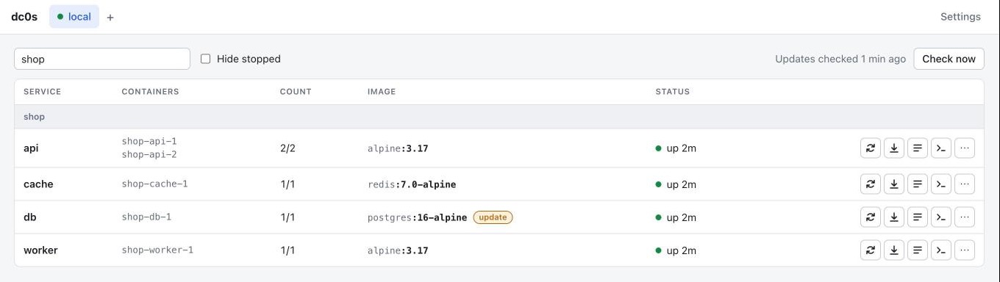

# dc0s

One web page to look after Docker on several hosts. Pick a host, see what is
running, and do the things you do all day: restart a service, pull the newest
image for its tag and restart, read logs, look at environment variables, open a
shell.

It runs as a single container on your own machine and talks to each Docker
host over the same connection string you would put in `DOCKER_HOST`. Nothing is
installed on the hosts.




## What it does

- **Hosts as tabs.** Local socket, TCP with TLS, or SSH. One click switches host.
- **Services list.** Containers grouped the way Docker Compose made them, with
  container names, running/total count, image and tag, state, uptime and restart
  count. Stopped services are listed too: a crashed service is the one you most
  need to see.
- **Actions.** Restart, start and stop, on a whole service or on one container,
  and *pull & restart* for a whole service, with step-by-step progress.
- **Update badge.** Shows when the registry has a newer image for a service's tag.
- **Logs.** Live, searchable, downloadable; several containers of a service merged
  into one view.
- **Env.** Names are listed, values stay hidden until you reveal them.
- **Shell.** A terminal inside the container, in the browser. No SSH server in the
  container is needed.
- **Protected hosts.** Mark a host (production, say) so every action asks for the
  service name to be typed.

## Quick start

You need Docker.

```sh
git clone <this repository> dc0s
cd dc0s
docker compose up -d --build
```

Open <http://localhost:8080>. The Docker daemon of the machine you are on is
already there as host **local**.

Without Compose:

```sh
docker build -t dc0s .
docker network create dc0s
docker run -d --name dc0s \
  --network dc0s \
  --stop-timeout 180 \
  -p 127.0.0.1:8080:8080 \
  -v dc0s-data:/data \
  -v /var/run/docker.sock:/var/run/docker.sock \
  dc0s
```

Three details in both matter:

- The port is published on `127.0.0.1` only, so the panel is not reachable from
  other machines.
- The panel gets a network of its own. On Docker's default network every other
  container could reach it directly, without going through the published port.
- Stopping the panel waits up to three minutes for a running action to finish,
  rather than abandoning a container half replaced.

Read [Security](#security) before loosening any of this.

## Adding hosts

**Settings → Hosts → Add a host.** A host has a name and a connection URL — the
same value `DOCKER_HOST` takes.

| Connection | URL | Needs |
|---|---|---|
| Local socket | `unix:///var/run/docker.sock` | The socket mounted into the panel's container |
| TCP | `tcp://10.0.0.5:2376` | The daemon listening on TCP; TLS certificates pasted into the form |
| SSH | `ssh://deploy@server.example.com` | SSH access for that user, who can run `docker` on the server |

"Test connection" tells you the Docker version on success, or what went wrong.

### Connecting over SSH

The panel runs the ordinary `ssh` client inside its container, so it needs your
keys or your SSH agent. Give it one of them.

**Your keys** (any system) — mount your `.ssh` folder read-only at `/ssh`:

```sh
# Linux and macOS
-v ~/.ssh:/ssh:ro

# Windows (PowerShell)
-v ${env:USERPROFILE}\.ssh:/ssh:ro
```

At start the panel copies what it finds there to where `ssh` reads it, owned by
its own user and readable by nobody else. (`ssh` refuses a config file owned by
someone else and a key that others can read, which is what a folder mounted
straight from Linux or Windows looks like from inside a container.) Your own
files are not touched. Restart the panel after changing your keys or config.

Keys with a passphrase cannot be unlocked this way (there is nobody to type it);
use the agent instead.

**Your SSH agent** — pass its socket in:

```sh
# Linux
-v $SSH_AUTH_SOCK:/ssh-agent -e SSH_AUTH_SOCK=/ssh-agent

# macOS with Docker Desktop
-v /run/host-services/ssh-auth.sock:/ssh-agent -e SSH_AUTH_SOCK=/ssh-agent
```

On Windows, mount the keys; forwarding the Windows agent into a container is
not something Docker Desktop offers.

In `compose.yaml` these go under `volumes:` and `environment:`; the key mount is
there already, commented out.

Things worth knowing:

- The first time the panel sees a server it accepts and remembers the server's
  host key (kept in the data volume). If the key later changes, the connection
  is refused, as `ssh` itself would.
- A port and a non-default Docker socket fit in the URL:
  `ssh://deploy@server.example.com:2222/run/user/1000/docker.sock`.
- Your `~/.ssh/config` is honoured when you mount the folder as above (host
  aliases, jump hosts, identities). Paths in it are read inside the container:
  `~/.ssh/…` works, an absolute path from your machine does not.
- The user must be able to run `docker` on the server without a password
  prompt.

### TCP with TLS

For `tcp://` hosts, tick **Secure with TLS certificates** and paste the CA
certificate, the client certificate and the client key as PEM text. They are
stored in the data volume and never sent back to the browser; when you edit the
host later, leave the fields blank to keep them.

## Actions

Actions on a service apply to each of its containers, one at a time.

**Restart, start, stop** are the plain Docker operations.

**Pull & restart** pulls the image reference the containers were created with,
then replaces every container that is behind it:

- The replacement keeps the name and everything *you* configured: environment,
  command, ports, volumes (anonymous ones included), networks, restart policy,
  labels. What the old *image* supplied by default is left behind, so the new
  image's defaults take effect.
- The image is pulled for the platform the containers already run, so a
  container run as `linux/amd64` on an ARM machine stays that way.
- Containers are replaced one by one. Each replacement must come up — stay
  running, and pass its health check if it has one — before the next is
  touched. If it stops, keeps restarting or turns unhealthy, the old container
  is put back and the action stops, so a bad image cannot take a whole service
  down.
- If a health check is still undecided when the wait ends, that container is
  left running on the new image, but the rest are **not** replaced; run the
  action again once it is healthy. The wait is at least two minutes
  (`DC0S_HEALTH_TIMEOUT`) and at least as long as the container's own
  health schedule needs to reach a verdict.
- If nothing new was pulled and nothing is behind, nothing is touched.
- Compose still recognises the containers afterwards.

A container is refused, with the reason, when it cannot be reproduced
faithfully: it shares another container's network (or another container shares
its), takes volumes from another container, uses legacy links, or was started
with `--rm`. The panel also refuses to replace its own container; update it
from outside (`docker compose up -d --build`, or run the new image).

While a container is being replaced, the old one is kept, stopped, under a
name ending in `-old-` and part of its ID. If the panel is killed at that
moment — stopping it normally waits for the action — the service stays down
until you rename that container back and start it:
`docker rename shop-api-1-old-1a2b3c4d shop-api-1 && docker start shop-api-1`.

**Rebuild** (from source) is not there yet; see [Not yet](#not-yet).

## Update badge

For each service the panel compares the digest of the image the host has with
the digest the registry serves for the same tag. It asks through the host's own
Docker daemon, so a registry that only the host can reach still works.

- **update** — a newer image exists. *Pull & restart* fetches it.
- **?** — the check could not decide; hover for why (needs a login, built or
  loaded locally, registry error).
- nothing — up to date, or pinned to an exact digest.

Checks run when you open a host's list and the last one is older than 15
minutes, when you press **Check now**, and after a pull. A list left open does
not keep checking: registries count these lookups (Docker Hub allows 100 per
six hours without a login), and using them up would make real pulls fail.

## Registry logins

**Settings → Registry logins.** Needed for private registries, both to pull and
to check for updates. Give the registry's address as it appears in image names:

| Registry | Address | Username | Password |
|---|---|---|---|
| Docker Hub | `docker.io` | your user | an access token |
| GitHub | `ghcr.io` | your user | a token with `read:packages` |
| Google Artifact Registry | `europe-west1-docker.pkg.dev` | `_json_key` | the service account key (JSON) |
| AWS ECR | `123456789.dkr.ecr.eu-west-1.amazonaws.com` | `AWS` | output of `aws ecr get-login-password` |

ECR tokens last 12 hours and are not refreshed for you yet.

Passwords are stored in the data volume, readable only by its owner, and are
never sent back to the browser.

## Security

The panel can open shells in your containers and show their secrets. Its
defaults assume it is yours alone, on your machine:

- The port is published on `127.0.0.1` only.
- It answers only requests addressed to `localhost`, `127.0.0.1` or `::1`, and
  refuses actions and live connections started by other websites. (Without
  this, a web page you visit could drive a panel on your machine.)

What the defaults do not cover: without a password, anything that can open a
connection to the panel can use it. That includes other accounts on your
machine, and any container you put on the panel's own network. If either
worries you, set a password.

To use it from other machines on a private network:

1. Set a password: `DC0S_PASSWORD` (or `DC0S_PASSWORD_FILE`).
2. Add the hostname you will reach it by: `DC0S_ALLOWED_HOSTS=panel.lan`.
3. Publish the port more widely (`-p 8080:8080`), ideally behind a reverse
   proxy that adds HTTPS. The proxy must pass the `Host` header through
   unchanged and allow WebSocket upgrades, or logs and shells will not
   connect.

There is one password and no user accounts. Do not expose the panel to the
internet. More in [SECURITY.md](SECURITY.md).

## Configuration

Environment variables, all optional:

| Variable | Default | Meaning |
|---|---|---|
| `DC0S_ADDR` | `:8080` in the image | Address to listen on. The program run outside the image defaults to `127.0.0.1:8080` |
| `DC0S_DATA_DIR` | `/data` | Where hosts, logins and SSH host keys are kept |
| `DC0S_PASSWORD` | none | Require this password |
| `DC0S_PASSWORD_FILE` | none | Read the password from a file (Docker secrets) |
| `DC0S_ALLOWED_HOSTS` | none | Extra hostnames to answer to, comma-separated |
| `DC0S_HEALTH_TIMEOUT` | `2m` | How long a replaced container may take to become healthy |
| `DC0S_LOCAL_SOCKET` | `/var/run/docker.sock` | Socket offered as host "local" on first run |
| `DC0S_SSH_DIR` | `/ssh` | Folder of SSH keys and config to copy into place at start |

Everything the panel saves is one JSON file in the data volume,
`dc0s.json`. Back it up, or edit it by hand while the panel is stopped.

## Not yet

In rough order: rebuild from source, automatic ECR and cloud registry logins,
live CPU and memory, a history of actions, comparing a service across hosts,
disk usage and cleanup, scaling, Swarm, user accounts.

Want one of them? Actions, tabs and registry login types are each a small,
self-contained addition: see [CONTRIBUTING](CONTRIBUTING.md).

## Licence

[MIT](LICENSE)
