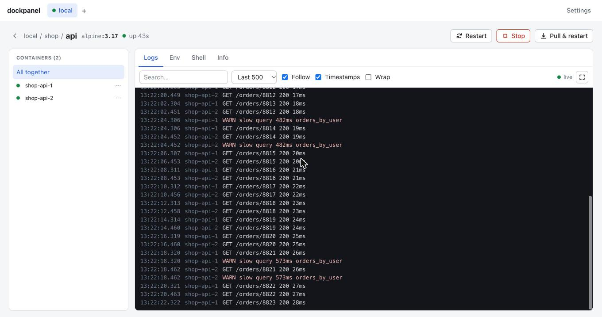

# dockpanel

One web page to look after Docker on several hosts. Pick a host, see what is
running, and do the things you do all day: restart a service, pull the newest
image for its tag and restart, read logs, look at environment variables, open a
shell.

It runs as a single container on your own machine and talks to each Docker
host over the same connection string you would put in `DOCKER_HOST`. Nothing is
installed on the hosts.




> `dockpanel` is a working name. It is defined in one place and easy to change;
> see [CONTRIBUTING](CONTRIBUTING.md#the-name).

## What it does

- **Hosts as tabs.** Local socket, TCP with TLS, or SSH. One click switches host.
- **Services list.** Containers grouped the way Docker Compose made them, with
  container names, running/total count, image and tag, state, uptime and restart
  count. Stopped services are listed too: a crashed service is the one you most
  need to see.
- **Actions.** Restart, start, stop, and *pull & restart*, on a whole service or
  on one container, with step-by-step progress.
- **Update badge.** Shows when the registry has a newer image for a service's tag.
- **Logs.** Live, searchable, downloadable; several containers of a service merged
  into one view.
- **Env.** Names are listed, values stay hidden until you reveal them.
- **Shell.** A terminal inside the container, in the browser. No SSH server in the
  container is needed.
- **Protected hosts.** Mark a host (production, say) so every action asks for the
  service name to be typed.

## Quick start

You need Docker.

```sh
git clone <this repository> dockpanel
cd dockpanel
docker compose up -d --build
```

Open <http://localhost:8080>. The Docker daemon of the machine you are on is
already there as host **local**.

Without Compose:

```sh
docker build -t dockpanel .
docker run -d --name dockpanel \
  -p 127.0.0.1:8080:8080 \
  -v dockpanel-data:/data \
  -v /var/run/docker.sock:/var/run/docker.sock \
  dockpanel
```

Both publish the port on `127.0.0.1` only, so the panel is reachable from your
machine and nowhere else. Read [Security](#security) before changing that.

## Adding hosts

**Settings → Hosts → Add a host.** A host has a name and a connection URL — the
same value `DOCKER_HOST` takes.

| Connection | URL | Needs |
|---|---|---|
| Local socket | `unix:///var/run/docker.sock` | The socket mounted into the panel's container |
| TCP | `tcp://10.0.0.5:2376` | The daemon listening on TCP; TLS certificates pasted into the form |
| SSH | `ssh://deploy@server.example.com` | SSH access for that user, who can run `docker` on the server |

"Test connection" tells you the Docker version on success, or what went wrong.

### Connecting over SSH

The panel runs the ordinary `ssh` client inside its container, so it needs your
keys or your SSH agent. Give it one of them.

**Your keys** (any system) — mount your `.ssh` folder read-only:

```sh
# Linux and macOS
-v ~/.ssh:/root/.ssh:ro

# Windows (PowerShell)
-v ${env:USERPROFILE}\.ssh:/root/.ssh:ro
```

Keys with a passphrase cannot be unlocked this way (there is nobody to type it);
use the agent instead.

**Your SSH agent** — pass its socket in:

```sh
# Linux
-v $SSH_AUTH_SOCK:/ssh-agent -e SSH_AUTH_SOCK=/ssh-agent

# macOS with Docker Desktop
-v /run/host-services/ssh-auth.sock:/ssh-agent -e SSH_AUTH_SOCK=/ssh-agent
```

In `compose.yaml` these go under `volumes:` and `environment:`; the key mount is
there already, commented out.

Things worth knowing:

- The first time the panel sees a server it accepts and remembers the server's
  host key (kept in the data volume). If the key later changes, the connection
  is refused, as `ssh` itself would.
- A port and a non-default Docker socket fit in the URL:
  `ssh://deploy@server.example.com:2222/run/user/1000/docker.sock`.
- Your `~/.ssh/config` is honoured (host aliases, jump hosts, identities).

### TCP with TLS

For `tcp://` hosts, tick **Secure with TLS certificates** and paste the CA
certificate, the client certificate and the client key as PEM text. They are
stored in the data volume and never sent back to the browser; when you edit the
host later, leave the fields blank to keep them.

## Actions

Actions on a service apply to each of its containers, one at a time.

**Restart, start, stop** are the plain Docker operations.

**Pull & restart** pulls the image reference the containers were created with,
then replaces every container that is behind it:

- The replacement keeps the name and everything *you* configured: environment,
  command, ports, volumes (anonymous ones included), networks, restart policy,
  labels. What the old *image* supplied by default is left behind, so the new
  image's defaults take effect.
- Containers are replaced one by one. Each replacement must come up — stay
  running, and pass its health check if it has one — before the next is
  touched. If it does not, the old container is put back and the action stops,
  so a bad image cannot take a whole service down.
- If nothing new was pulled and nothing is behind, nothing is touched.
- Compose still recognises the containers afterwards.

A container is refused, with the reason, when it cannot be reproduced
faithfully: it shares another container's network, takes volumes from another
container, uses legacy links, or was started with `--rm`.

**Rebuild** (from source) is not there yet; see [Not yet](#not-yet).

## Update badge

For each service the panel compares the digest of the image the host has with
the digest the registry serves for the same tag. It asks through the host's own
Docker daemon, so a registry that only the host can reach still works.

- **update** — a newer image exists. *Pull & restart* fetches it.
- **?** — the check could not decide; hover for why (needs a login, built or
  loaded locally, registry error).
- nothing — up to date, or pinned to an exact digest.

Checks run when you open a host and the last one is older than 15 minutes, and
when you press **Check now**.

## Registry logins

**Settings → Registry logins.** Needed for private registries, both to pull and
to check for updates. Give the registry's address as it appears in image names:

| Registry | Address | Username | Password |
|---|---|---|---|
| Docker Hub | `docker.io` | your user | an access token |
| GitHub | `ghcr.io` | your user | a token with `read:packages` |
| Google Artifact Registry | `europe-west1-docker.pkg.dev` | `_json_key` | the service account key (JSON) |
| AWS ECR | `123456789.dkr.ecr.eu-west-1.amazonaws.com` | `AWS` | output of `aws ecr get-login-password` |

ECR tokens last 12 hours and are not refreshed for you yet.

Passwords are stored in the data volume, readable only by its owner, and are
never sent back to the browser.

## Security

The panel can open shells in your containers and show their secrets. Its
defaults assume it is yours alone, on your machine:

- The port is published on `127.0.0.1` only.
- It answers only requests addressed to `localhost`, `127.0.0.1` or `::1`, and
  refuses actions and live connections started by other websites. (Without
  this, a web page you visit could drive a panel on your machine.)

To use it from other machines on a private network:

1. Set a password: `DOCKPANEL_PASSWORD` (or `DOCKPANEL_PASSWORD_FILE`).
2. Add the hostname you will reach it by: `DOCKPANEL_ALLOWED_HOSTS=panel.lan`.
3. Publish the port more widely (`-p 8080:8080`), ideally behind a reverse
   proxy that adds HTTPS.

There is one password and no user accounts. Do not expose the panel to the
internet. More in [SECURITY.md](SECURITY.md).

## Configuration

Environment variables, all optional:

| Variable | Default | Meaning |
|---|---|---|
| `DOCKPANEL_ADDR` | `:8080` | Address to listen on, inside the container |
| `DOCKPANEL_DATA_DIR` | `/data` | Where hosts, logins and SSH host keys are kept |
| `DOCKPANEL_PASSWORD` | none | Require this password |
| `DOCKPANEL_PASSWORD_FILE` | none | Read the password from a file (Docker secrets) |
| `DOCKPANEL_ALLOWED_HOSTS` | none | Extra hostnames to answer to, comma-separated |
| `DOCKPANEL_HEALTH_TIMEOUT` | `2m` | How long a replaced container may take to become healthy |
| `DOCKPANEL_LOCAL_SOCKET` | `/var/run/docker.sock` | Socket offered as host "local" on first run |

Everything the panel saves is one JSON file in the data volume,
`dockpanel.json`. Back it up, or edit it by hand while the panel is stopped.

## Not yet

In rough order: rebuild from source, automatic ECR and cloud registry logins,
live CPU and memory, a history of actions, comparing a service across hosts,
disk usage and cleanup, scaling, Swarm, user accounts.

Want one of them? Actions, tabs and registry login types are each a small,
self-contained addition: see [CONTRIBUTING](CONTRIBUTING.md).

## Licence

[MIT](LICENSE)
